# 1541HUD OneROM — Public Releases

This repository is the public distribution point for 1541HUD OneROM releases.
It intentionally contains distributable artifacts and user documentation, not
the private development tree. Each artifact has a stated qualification level;
do not treat every file as universally hardware-validated merely because it is
in a repository. That would be a spectacularly efficient way to confuse a
checksum with an engineering result.

## Release status and trust boundary

This branch is a **public beta package**, not an immutable signed release.
The included SHA-256 manifests verify that a downloaded file matches the file
recorded in this repository revision; they do **not** authenticate the publisher
or prove that a mutable branch has not changed. The current package includes
unsigned 1541HUD Windows executables and firmware artifacts.

Use the package only for evaluation on hardware you are prepared to recover.
For a promoted release, obtain the artifact from a GitHub Release whose
protected tag and checksum manifest are signed, then follow
[release verification](docs/RELEASE_VERIFICATION.md). Until that exists, do
not treat this branch as a production distribution channel.

## What belongs here

- validated UB3 Control and UB4 Monitor firmware images;
- the Windows 1541HUD application release;
- C64 configurator release files;
- checksums, wiring, flashing, and installation documentation; and
- safe configuration examples that do not include private ROM files.

## What does not belong here

- private ROM inputs or licensed ROM images without redistribution rights;
- firmware source snapshots, private build environments, diagnostics, or
  experimental candidates; and
- internal patch-development notes.

The first public release is being assembled. Until a release is marked
validated, do not treat any artifact in this repository as flash-ready.

## Start here

1. Read [wiring and installation](docs/WIRING_AND_INSTALLATION.md) before
   opening the drive or connecting USB.
2. Confirm compatibility and ROM licensing in
   [Compatibility, Limitations, and ROM Licensing](docs/COMPATIBILITY_AND_LIMITATIONS.md).
3. Read the [hardware and use disclaimer](DISCLAIMER.md).
4. Verify the exact artifact using [SHA256SUMS.txt](SHA256SUMS.txt).
5. Read [release verification](docs/RELEASE_VERIFICATION.md) to understand what
   that checksum can and cannot prove.
6. Follow [flashing and recovery](docs/FLASHING.md) one board at a time.
7. Install 1541HUD and/or the C64 configurator after firmware validation.

## Optional control wiring

The UB3 ROM/USB Control function does **not** require the programmable IEC
address wiring or the write-protect override circuit. Those are independent,
optional installation features: leave the 1541's normal address straps in
place when programmable IEC addressing is not wanted, and omit the X2/GPIO8
transistor circuit when write-protect override is not wanted. X1 is separate:
it is required whenever UB3 must serve both halves of the 1541 ROM address
range.

## Installation photos

These photographs show the hardware-qualified development/test installation.
They are reference examples, not a substitute for the pinout and electrical
rules in the [wiring guide](docs/WIRING_AND_INSTALLATION.md). In particular,
the IC test clips are temporary validation tools; do not treat their placement
or wire colours as a universal 1541 wiring standard.

| Paired OneROM installation | Temporary IEC-selector verification |
| --- | --- |
| 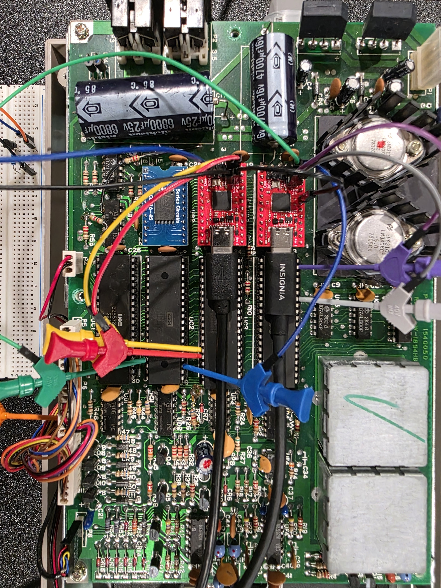 | 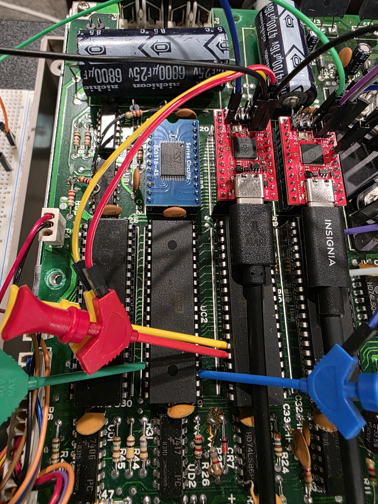 |
| Two Fire-24E boards installed for the UB3 Control / UB4 Monitor paired layout. | Temporary test clips used to verify the IEC selector mapping before permanent modification. |

| Installed-board detail | Optional write-protect test circuit |
| --- | --- |
| 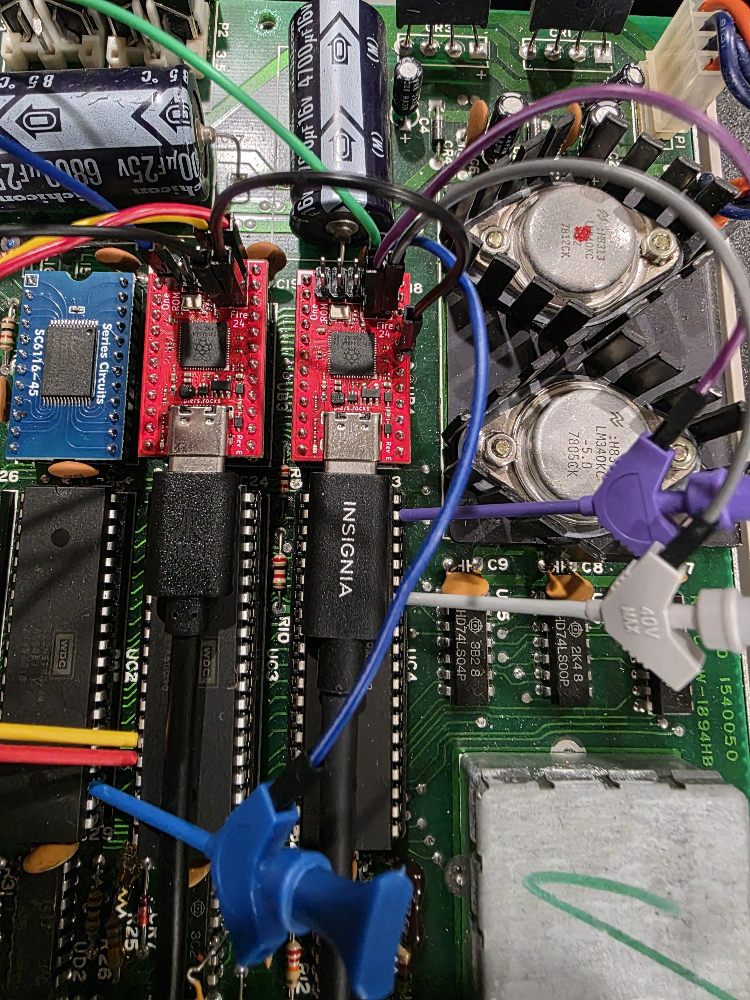 | 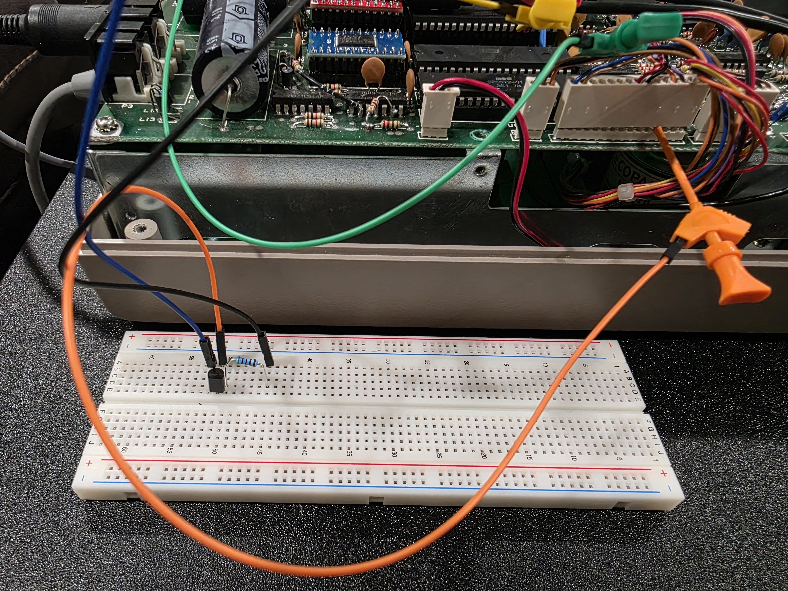 |
| Detail view of the paired OneROM installation and temporary test leads. | Breadboard validation of the optional X2/GPIO8 write-protect override transistor circuit before permanent wiring. |

## Components

- `firmware-monitor/` contains the complete UB4 V0.8.0.14 passive Monitor
  image and its checksum. It is upper-socket-only and must be paired with a
  compatible UB3 Control installation.
- `firmware-control/` contains the UB3 custom-composition kit: patched V8
  base, compiled plugins, bootloader, verified CLI, and no-JiffyDOS example
  manifests.
- `c64-onerom-configurator/` contains the V0.8.0.01 C64 `.PRG` and `.d64`
  release files.
- `1541hud/` contains the portable Windows V0.8.0.14 application and its
  checksum.

## V0.8.0.14 RPM measurement

V0.8.0.14 adds passive, live RPM measurement while normal disk software is
running. It does not write a test sector, require a test disk, or add a spindle
sensor. After the Monitor sees a checksum-valid physical header, it uses that
header only to establish the standard density-zone geometry. It then timestamps
raw SYNC marks over two complete disk revolutions to calculate RPM.

The timer does not wait for the same header or sector to return. Standard 1541
geometry supplies the revolution boundary: 42, 38, 36, or 34 SYNC marks per
revolution for density zones 3 through 0 respectively. The measured RPM also
feeds the HUD's expected-SYNC, SYNC-per-revolution, density-validation, and
card-detail calculations.

During a seek or unreadable interval, V14 retains the last confirmed RPM rather
than showing an incomplete sample. When the motor stops, the RPM card shows
`--.--`. The method is intended for standard readable GCR tracks, including
many commercial disks with protection elsewhere. Deliberately nonstandard or
unreadable protection tracks may not produce enough valid evidence; the HUD
will hold the last confirmed value or report RPM as unavailable rather than
inventing a number.

## 1541HUD V0.8.0.13 screenshots

The Windows HUD combines passive UB4 evidence with confirmed UB3 Control
operations. The Control-feature checkbox card visibly reminds the operator
that programmable IEC addressing requires SEL_A/SEL_B wiring and write-protect
override requires the optional X2/GPIO8 transistor circuit.

| Live dashboard | Protected idle state |
| --- | --- |
| 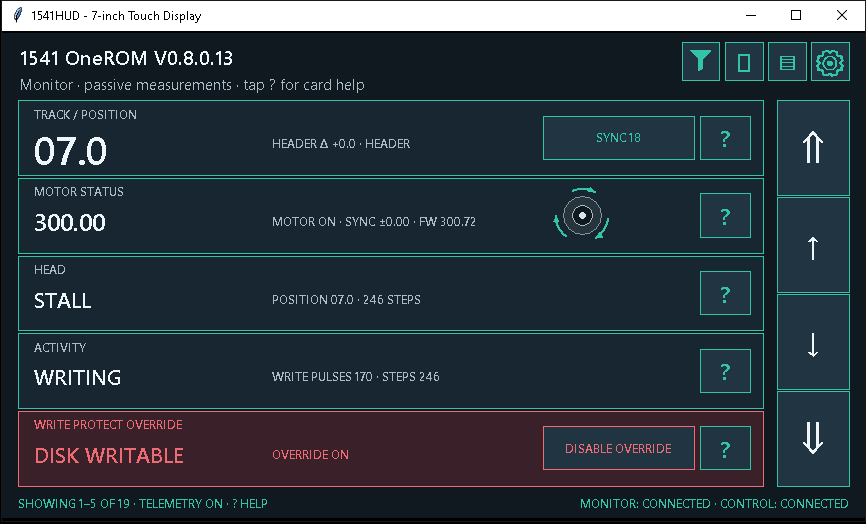 | 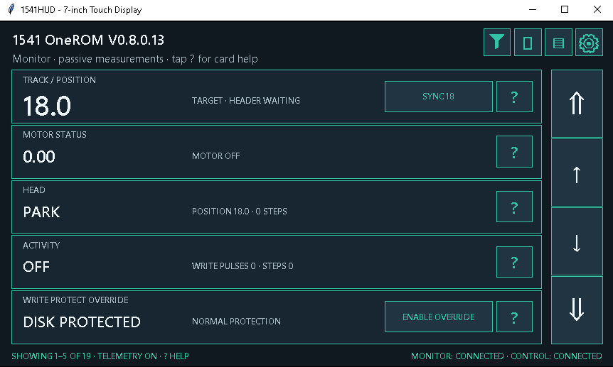 |

| Control-feature wiring reminder | Control OneROM assignment |
| --- | --- |
| 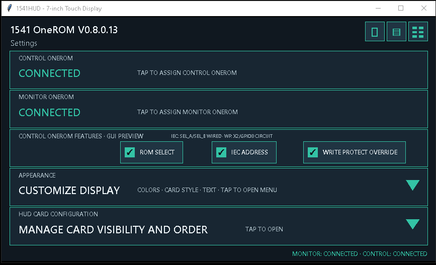 | 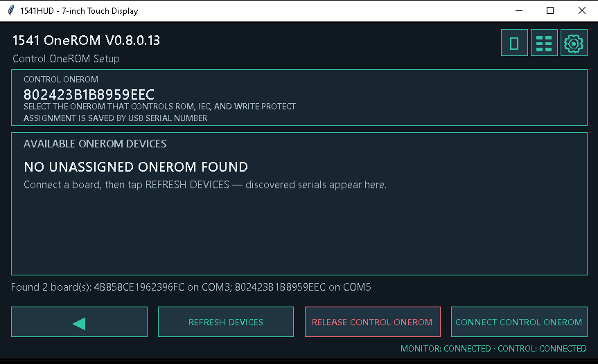 |

| Activity log | Card configuration |
| --- | --- |
| 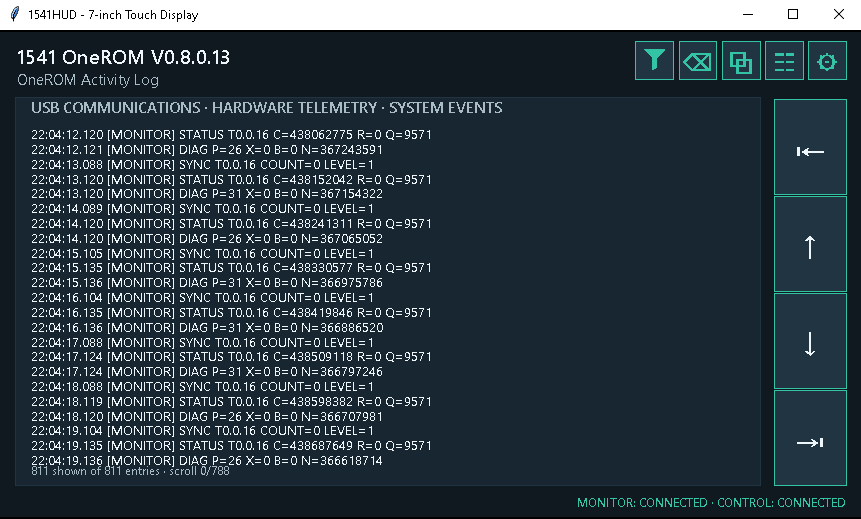 | 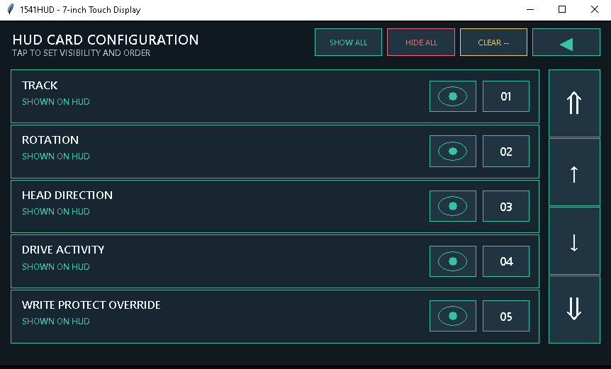 |

| Appearance controls |
| --- |
| 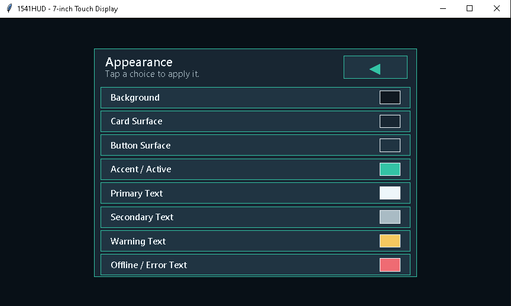 |

## C64 Configurator hardware validation

The C64 Configurator V0.8.0.01 was validated on real C64/1541 hardware for
drive discovery, dynamic ROM-slot listing, ROM startup selection, persistent
IEC-address changes, and temporary IEC-address use. The ROM labels in these
photos are from the test configuration; this public repository does not ship
licensed replacement ROM images. The full validation sequence is retained in
the [Configurator technical reference](c64-onerom-configurator/TECHNICAL_REFERENCE.md).

| Drive polling | OneROM service discovery |
| --- | --- |
| 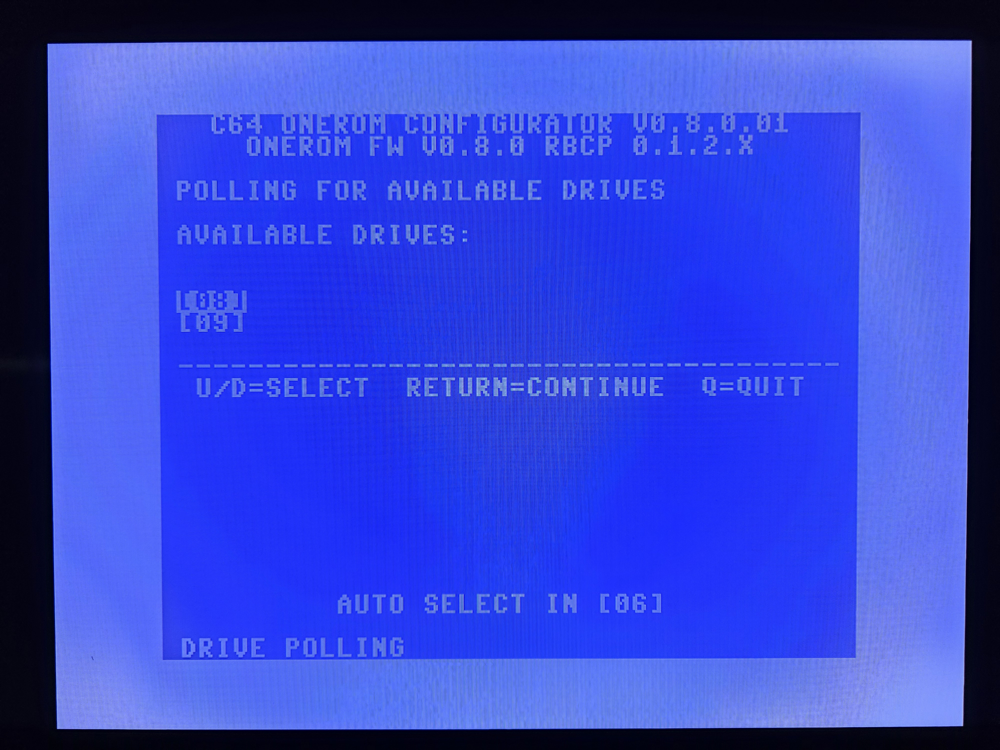 | 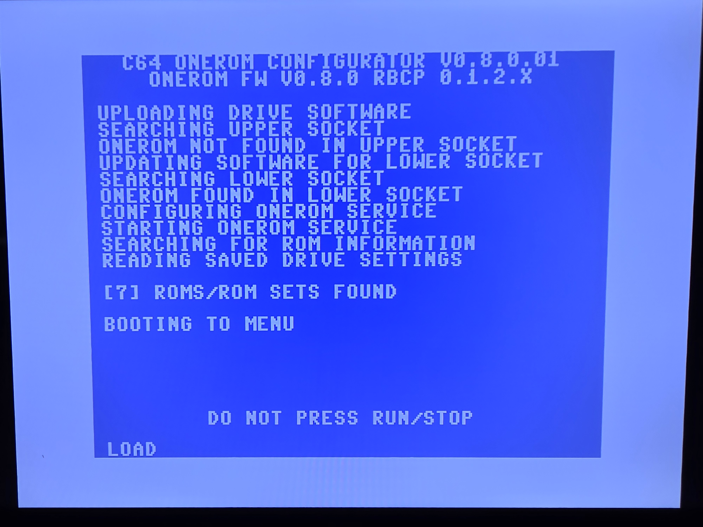 |

| ROM selection | IEC address entry |
| --- | --- |
| 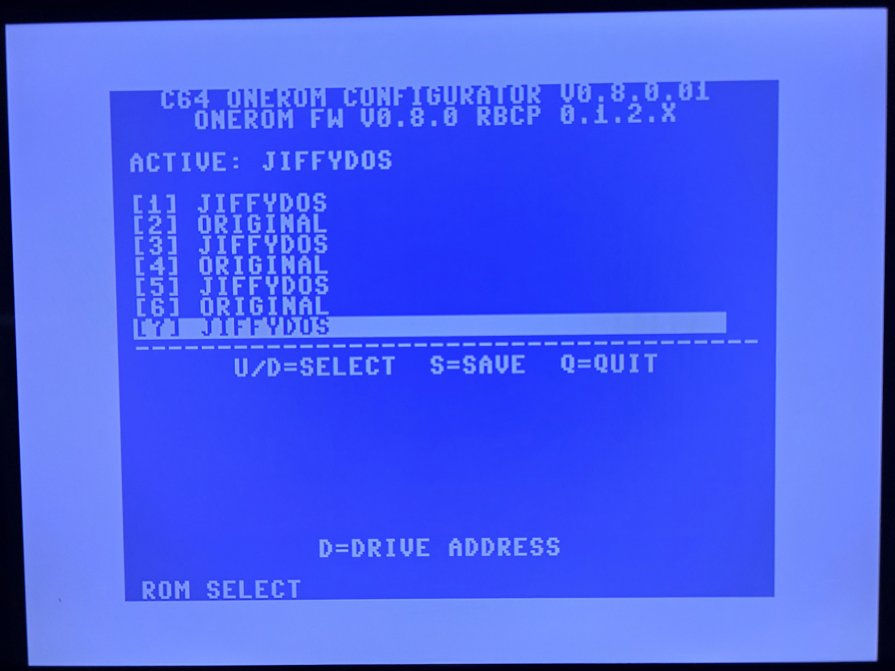 | 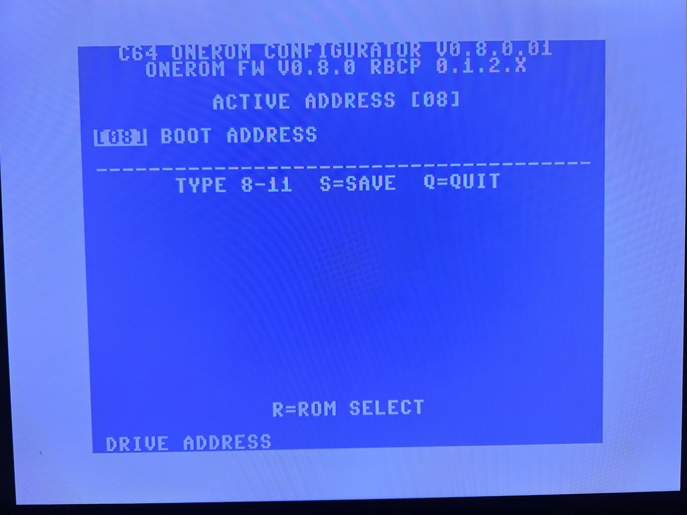 |

The full artifact inventory, exact target roles, and qualification status are
in [RELEASE_MANIFEST.md](RELEASE_MANIFEST.md).

Original project material is released under the [MIT License](LICENSE).
Release-package changes are tracked in [CHANGELOG.md](CHANGELOG.md).
