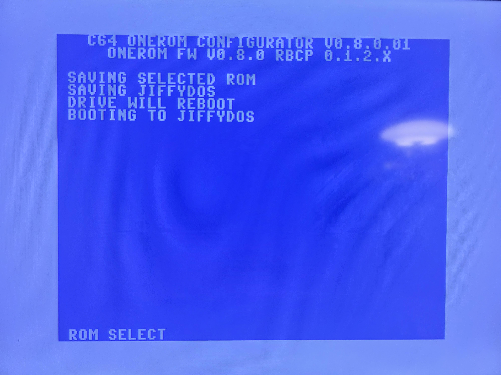
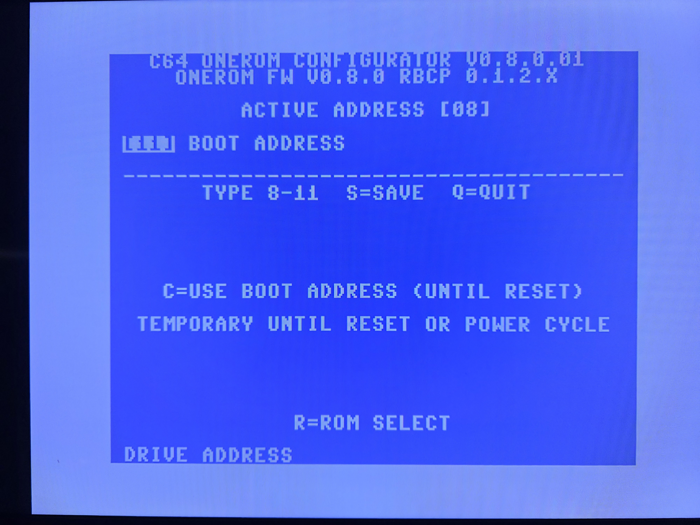
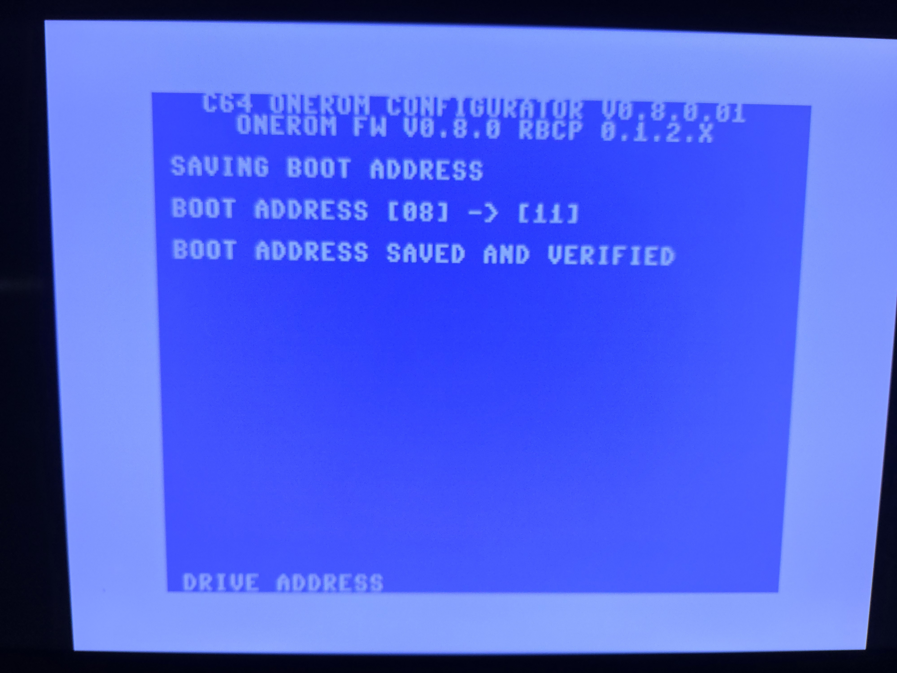
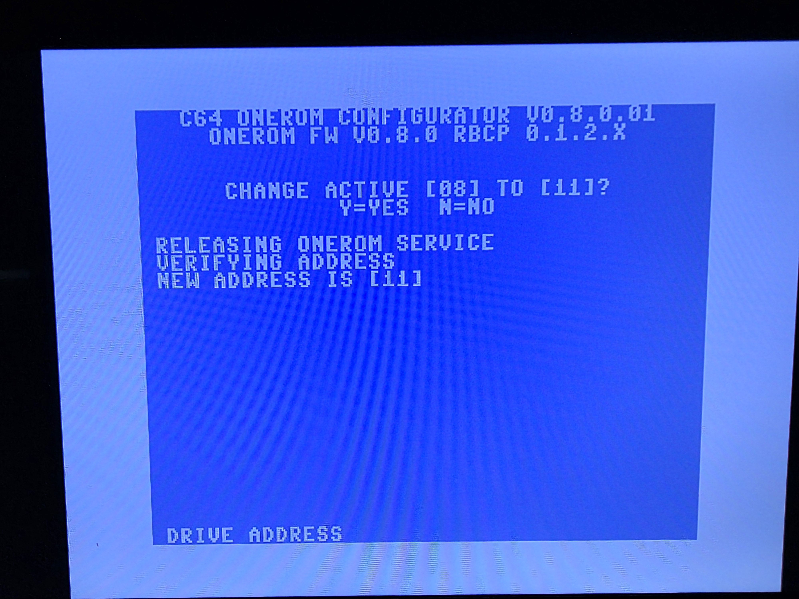

# C64 OneROM Configurator Technical Reference

The V0.8.0.01 C64 configurator is a C64-side client for supported OneROM
Control settings. It provides ROM-slot discovery/selection and IEC-address
control using the OneROM protocol. It obtains slot names from the Control image
metadata rather than deriving labels from ROM URLs.

The release preserves the established quit paths and the temporary IEC-address
workflow. Those flows are intentionally not changed in this package. After a
setting change, verify it through the configurator or 1541HUD and then perform
a cold 1541 reboot with UB3 USB VBUS absent to prove the saved startup state
was reread.

The configurator is not a ROM image distributor and contains no licensed DOS
replacement. It requires a compatible UB3 V0.8 Control image with the USB and
Host-Control components supplied by this release family.

## Hardware validation gallery

The images below document a real-hardware V0.8.0.01 validation run. They show
the complete user-facing flow: drive polling, lower-socket service discovery,
dynamic ROM-list display, persistent ROM selection, persistent boot-address
save, and temporary IEC-address verification. Any JiffyDOS labels shown are
from a private test configuration and are not supplied by this release.

| Drive discovery | Control service discovery |
| --- | --- |
|  |  |

| ROM selection | ROM selection saved |
| --- | --- |
|  |  |

| Address menu | Address entry |
| --- | --- |
|  |  |

| Persistent address | Temporary address |
| --- | --- |
|  |  |
